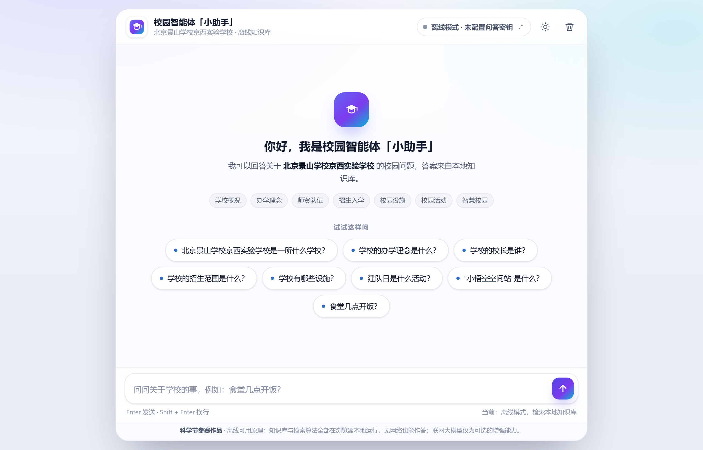
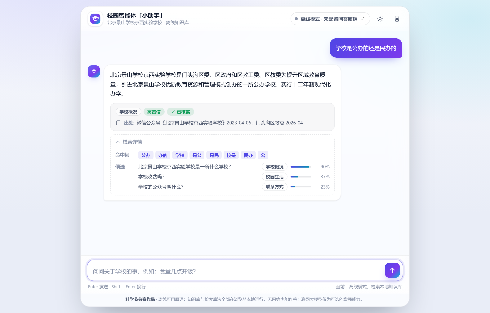
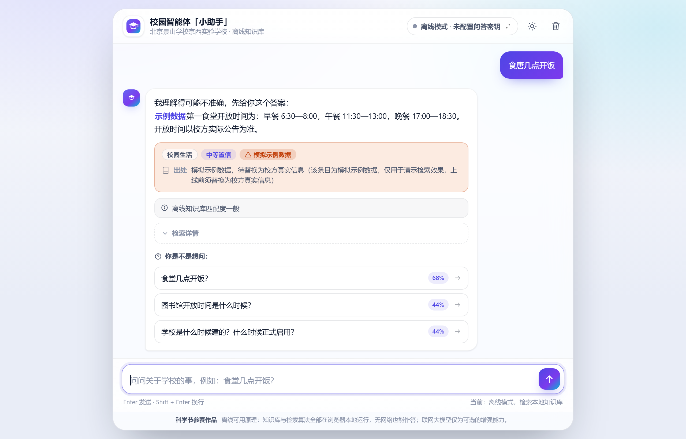
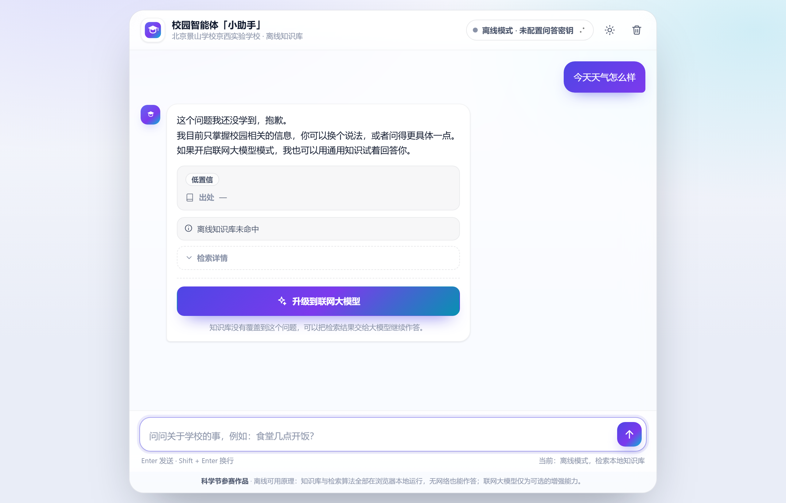
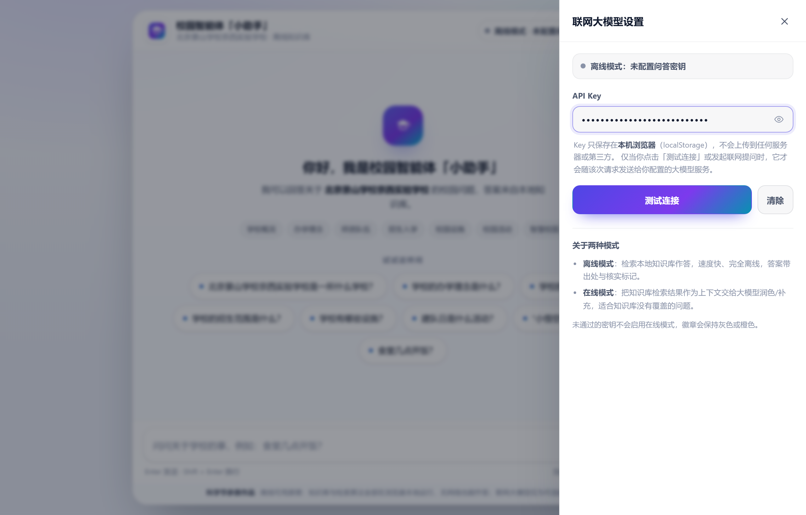
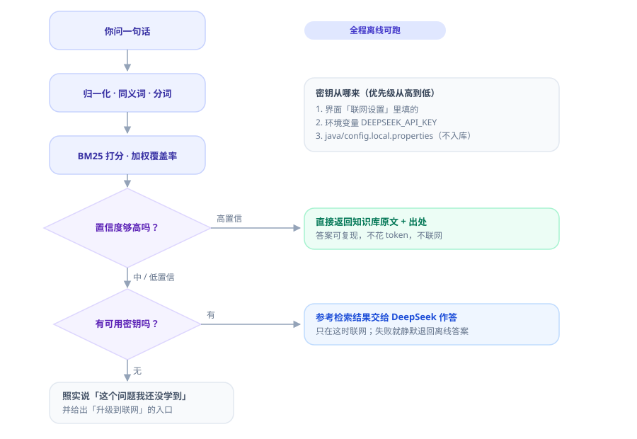
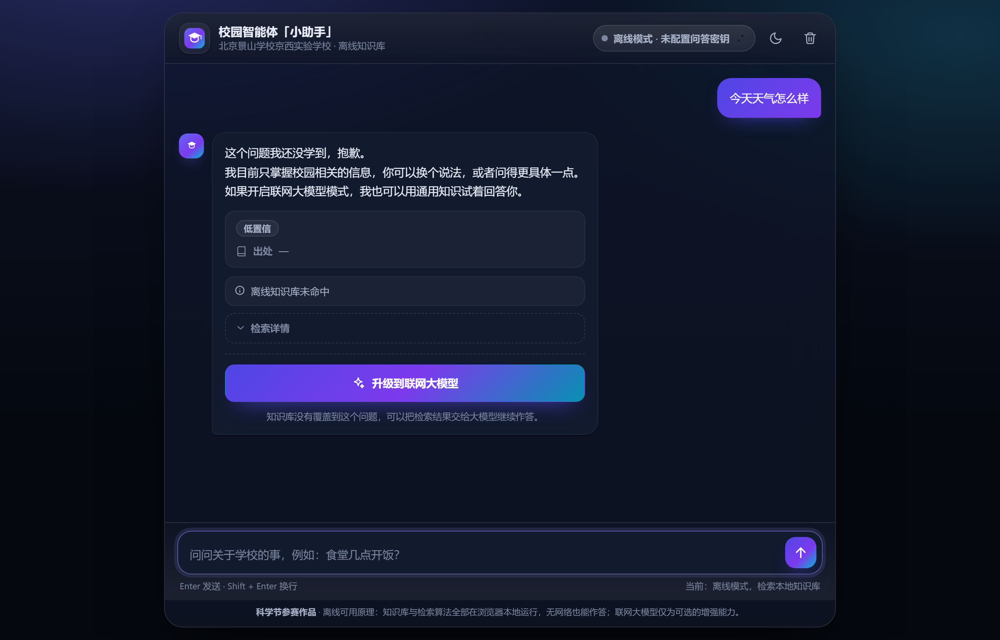
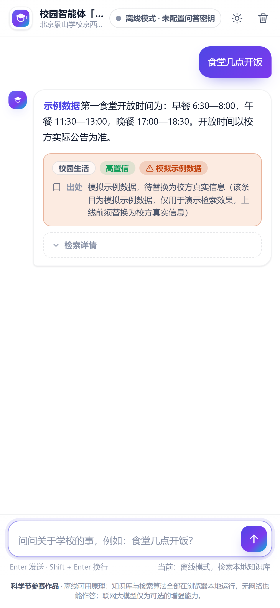

# 校园智能体「小助手」

**不联网也能回答校园问题。** 装好 JDK，双击 `java\run.bat`，一个没有地址栏的窗口就弹出来了，看起来就是个桌面应用。

它是北京景山学校京西实验学校的校园问答小助手：你把问题打进去，它先去本地知识库里找；找到了就直接给你答案，还告诉你答案是从哪来的；找不到就老实说没学到——如果你配了 API Key，它会再把这个问题交给大模型（DeepSeek）接着答。



> 上面这张图是在**没有配置任何 API Key** 的状态下截的，页脚写着「当前：离线模式，检索本地知识库」——离线是默认状态，不是出故障后的兜底。

---

## 它怎么答你的问题

小助手把每个问题分成三种情况处理，你可以先看清楚它的脾气：

### 一、答得上来 —— 直接给答案，并且交代出处



注意三件事：

- 绿色的 **「已核实」** 表示这条答案来自学校公开信息（微信公众号、北京考试报、首都之窗等），卡片下方写明了具体出处。
- **「检索详情」** 可以点开，里面是它命中了哪些词、以及它同时考虑过的另外几条候选问题（覆盖率条就是排序依据）。检索过程完全可解释，不是黑箱。
- 这一档**不联网、不花 token**，答案每次都一样，方便你在评委面前复现。

### 二、有点拿不准 —— 给答案，同时问你是不是想问别的



它会先给一个答案，但加一句「我理解得可能不准确」，并把另外几条它觉得更像的问题摆出来让你点。橙色角标 **「模拟示例数据」** 是在提醒：这条内容还是占位数据，上线前要换成校方真实信息。

### 三、没学过 —— 不硬答



它宁可说「这个问题我还没学到」，也不编一个看起来很像的答案。下面那个渐变的 **「升级到联网大模型」** 按钮，就是给这种情况准备的出口。

> 关于「不硬答」：早期版本做过错别字自动纠错，实测后**主动移除**了——中文里编辑距离为 1 的两个词常常只是共用了一个字，会把「今天天气怎么样」硬拽到「作息时间」这类条目上，导致本该说不知道的问题被硬答。现在改成用单字兜底：写错一个字仍能命中，只是置信度降为「中等」。**移除纠错后所有阈值都保持原值未调整**。

---

## 三步就能跑起来

1. **装 JDK 17 或更高**（实测 JDK 21）。在终端里敲 `java -version` 能看到版本号就行。不需要 Maven / Gradle，也没有任何第三方依赖。
2. **双击 `java\run.bat`**。它会自动编译、启动服务，并用 Edge/Chrome 的应用模式弹出窗口。控制台会打印访问地址和当前模式；关掉窗口就停止服务。
3. **在输入框里提问**，Enter 发送，Shift + Enter 换行。

不想开窗口（自动化测试用）：

```
java\run.bat --no-browser
```

### 不想装 Java？用纯网页版

把 `docs/` 目录直接发布到 **GitHub Pages** 就行——前端只有一份，没有后端时页面会自动切换到浏览器里的 JS 引擎，功能完全一致（联网升级也支持，浏览器可以直连 DeepSeek）。

本地预览：

```
cd docs
python -m http.server 8000
```

注意必须通过 **HTTP 访问**。直接双击 HTML 用 `file://` 打开会被浏览器拦住，读不到本地 JSON 数据文件——页面会给出明确提示，不会白屏。

---

## 你可以照着这些问

| 你可以这样问 | 它的表现 |
|---|---|
| 学校是公办的还是民办的？ | 高置信，带「已核实」出处 |
| 三个面向指的是什么？ | 高置信，答办学理念 |
| 学校每班多少人？老师都是什么学历？ | 高置信 |
| 怎么请假？ | 高置信，答流程 |
| 校园卡丢了怎么办？ | 高置信 |
| 校服什么时候穿？上下学有校车吗？ | 高置信 |
| 图书馆一次能借几本书？ | 高置信 |
| 食唐几点开饭？（故意写错一个字） | 中等置信，降级但仍能答，并列出候选问题 |
| 今天天气怎么样？ | 低置信，明说没学到，给出升级入口 |
| 帮我写一首关于春天的诗 | 低置信，同样不硬答 |

这些问题都是拿真实运行日志核对过的，不是设想。想自己批量验，见下面的「验证」。

---

## 想让它更聪明？配一个 Key（可选）

大模型是**增强**，不是前提。不配也能完整使用。想启用时三选一：

1. **在界面上填**（最简单）：点右上角的「离线模式」徽章，打开设置面板，粘进去即可。Key 只存在你自己浏览器的 localStorage 里，不会上传到任何服务器。

   

2. **环境变量**：设置 `DEEPSEEK_API_KEY`，服务端启动时自动探测。
3. **本地配置文件**：在 `java/` 下新建 `config.local.properties`：

```properties
deepseek.api.key=sk-你的密钥
```

该文件已在 `.gitignore` 里，不会被提交。

> 优先级：**界面上填的 > 环境变量 > 本地配置文件**。这样「测试连接」按钮测的一定是你刚填的那把 Key，不会被服务端已有的配置顶掉。

配好之后，页面上方徽章会变成绿色「在线模式 · DeepSeek」。这时只有**中/低置信**的问题才会联网——高置信的问题仍然离线直接答。

---

## 它是怎么决定「该不该答」的



整条流水线没有机器学习模型，是一串可解释、可复现的规则：归一化 → 同义词整串替换 → 一元组+二元组混合分词 → 停用词过滤 → 多字段 BM25 打分 → 加权覆盖率 → 置信度分档。判断「该不该答」时同时看两个指标——**加权覆盖率**（命中词权重和 ÷ 查询词权重和）和**与第二名的分差比例**，只有两个都够高才算「答得上」。

加权覆盖率是「不硬答」的关键：不按命中的词个数算，避免「天」「样」这类常见单字凑出虚高的覆盖率。

---

## 深色模式、手机上也行

界面跟随系统深浅色，也可以手动切换（顶部太阳/月亮按钮）。



窄屏会自动重排成单列，气泡铺满、来源卡换行，输入区固定在底部。



---

## 数据说明（重要）

`docs/data/kb.json` 目前 **42 条**，分两类，请务必区分：

- **`verified: true`（23 条）** —— 来自学校公开信息，`source` 字段写明具体出处。
- **`verified: false`（19 条）** —— **模拟示例数据**，仅用于测试检索效果。答案带 `【示例数据】` 前缀，联系电话用 `010-XXXX XXXX` 占位，界面上打橙色「模拟示例数据」角标。

**正式提交或上线前，必须把这 19 条替换为校方真实信息。** `meta.integrity_note` 里也写明了这一点。这样做是为了不把测试数据冒充成校方数据。

---

## 验证

```
node tools/equiv-check.js     # 双引擎等价性：28 条用例两侧输出必须逐字节一致
node tools/js-selftest.js     # 只跑 JS 侧
node tools/explain.js "食堂几点开饭"    # 解剖 JS 引擎单条查询的打分过程

cd java
build.bat                                            # 编译
java -cp out campus.SelfTest                          # 只跑 Java 侧自测
java -cp out campus.SelfTest --explain "食堂几点开饭"   # 解剖 Java 引擎（与 explain.js 同口径，可直接比对）
```

同一套引擎用 **Java** 和 **JavaScript** 各写了一份，读同一份知识库、同一份参数文件。`equiv-check.js` 会同时跑两侧自测，把 `查询 / top1 / 置信度 / 覆盖率 / PASS|FAIL` 逐行比对，有任何一行不一致都会打印左右两边的原始值。

**改动任一侧引擎后都应该跑一次**，这是防止两边慢慢长歪的唯一办法。

---

## 常见问题

**页面提示「以 file:// 直接打开」** —— 浏览器禁止 `file://` 页面读取本地 JSON。请用 `java\run.bat`，或在 `docs` 目录下跑 `python -m http.server`。

**徽章一直显示离线模式** —— 说明没有可用的 Key。点徽章打开设置面板填入即可；若填了还是无效，点「测试连接」看具体原因（密钥无效 / 网络不可用）。密钥无效时徽章是橙色，网络不通时是灰色。

**刚问完想立刻追问，按钮点不动** —— 回答是逐字显示的打字机效果，这一两秒内输入框和发送按钮会临时禁用，动画结束自动恢复。正常语速提问不受影响。

**端口被占用** —— 服务会自动从 8080 往后试到 8099，控制台会打印实际地址。

---

## 技术细节

<details>
<summary>目录结构</summary>

```
docs/                       既是 GitHub Pages 站点，也是 Java 版前端的静态根目录（一份文件两处生效）
  index.html                单页对话界面
  assets/
    engine-js.js            JS 版离线检索引擎（与 Engine.java 严格对齐）
    llm-js.js               JS 版浏览器直连大模型
    app.js                  界面逻辑（先探测 /api/health，再决定走哪条链路）
    app.css                 样式（含深浅两套主题）
  data/                     ★ Java 与 JS 共享的唯一数据源
    kb.json                 知识库（42 条）
    synonyms.json           同义词表（40 组替换规则）
    config.json             全部算法参数（阈值、权重、提示语、接口地址）
    stopwords.json          停用词表
    testcases.json          双引擎等价性测试用例（28 条）
java/
  src/campus/
    Main.java               启动器：起服务 + 开应用窗口
    Server.java             本地 HTTP 服务 + 静态托管 + /api/health + /api/ask
    Router.java             分级路由：离线优先，缺失才联网
    Llm.java                DeepSeek 调用与探测
    Engine.java             离线检索引擎（Java 实现）
    Text.java               归一化 / 同义词 / 分词
    Data.java               数据文件定位与加载
    Json.java               极简 JSON 解析与序列化（不引入第三方库）
    SelfTest.java           自测（输出格式与 JS 侧一致，供逐行比对）
  build.bat                 编译
  run.bat                   编译 + 运行
  lib/                      第三方 jar 放这里（当前为空也能编译）
tools/
  js-selftest.js            JS 侧自测
  equiv-check.js            双引擎等价性校验
  explain.js                单条查询的打分过程解剖（排查用）
screenshots/                README 配图与流程图
```

</details>

<details>
<summary>接口契约</summary>

`GET /api/health` —— 前端启动时用 1500ms 超时探测，决定走哪条链路。

```json
{ "backend": "java", "version": "0.1.0", "school": "北京景山学校京西实验学校",
  "engine": { "impl": "java", "entries": 42, "synonymPairs": 40 },
  "llm": { "status": "no_key", "configured": false, "model": "" } }
```

`POST /api/ask` —— 请求体 `{ question, history, apiKey? }`，返回统一响应结构（`mode / confidence / answer / entryId / source / verified / candidates / matchedTerms / notice`）。两种链路（后端 API、浏览器本地引擎）返回同样的结构，前端只写一份渲染逻辑。

`llm.status` 取值 `no_key | unreachable | invalid_key | ok`，与徽章四态一一对应。`/api/health` 只读探测缓存（TTL 60 秒），不发网络请求，保证这个接口足够快。

</details>

<details>
<summary>算法七步</summary>

**1. 归一化** —— 全角转半角、转小写、非「汉字/字母/数字」一律替换为空格。标点换成空格而不是删除，避免产生跨标点的伪二元组。

**2. 同义词整串替换** —— 按变体长度从长到短排序做全局替换，保证长词优先。索引端和查询端走同一套替换，所以「餐厅」「饭堂」「伙食」都能命中「食堂」条目。

**3. 混合分词** —— 中文按**一元组 + 二元组**切分：`食堂几点开饭` → 单字 `食/堂/几/点/开/饭` 加双字 `食堂/堂几/几点/点开/开饭`。只用二元组对「换个说法问」召回太差，补上一元组后单字也能命中。二元组权重 1.0、一元组 0.45，保证真正的词比单字贡献更大。

**4. 停用词过滤** —— `的/是/在/什么/怎么样` 这类功能词在两处查询里都会命中，会把无关条目的覆盖率刷虚高。索引端与查询端都按 token 精确过滤。

**5. 多字段 BM25** —— `k1=1.2, b=0.75`，字段权重 `question 3.0 / keywords 2.5 / altQuestions 2.0 / answer 1.0`。同一个 token 在不同字段出现，得分按字段权重叠加。

**6. 加权覆盖率** —— 命中的查询词权重和 ÷ 查询词权重和。

**7. 置信度分档** —— 同时看覆盖率和「第一名与第二名的分差比例」：

- 覆盖率 ≥ 0.7 **且** 分差 ≥ 12% → `high`，直接返回知识库答案
- 覆盖率 ≥ 0.35 → `mid`，返回答案但加一句「我理解得可能不准确」，并列出候选问题
- 否则 → `low`，回答「这个问题我还没学到」，配置了 Key 时提供升级入口

</details>

<details>
<summary>为什么同一个引擎要写两遍</summary>

因为它要同时满足两个场景：**比赛现场**要有能双击启动、自带 HTTP 服务的桌面程序（Java 版）；**分享给别人**要能一个链接就打开（GitHub Pages 纯静态版）。两类环境跑不了同一份代码，但产品行为必须一致，所以引擎实现了两遍、数据只留一份。

风险不在于「某一侧算错」，而在于「两侧慢慢长歪」——改了一边忘了另一边，表现就是同一个问题在两台电脑上给出不同答案。所以有了 `equiv-check.js`：它同时跑两边自测并逐行比对。当前 28 条用例两侧输出**逐字节一致**。

</details>
